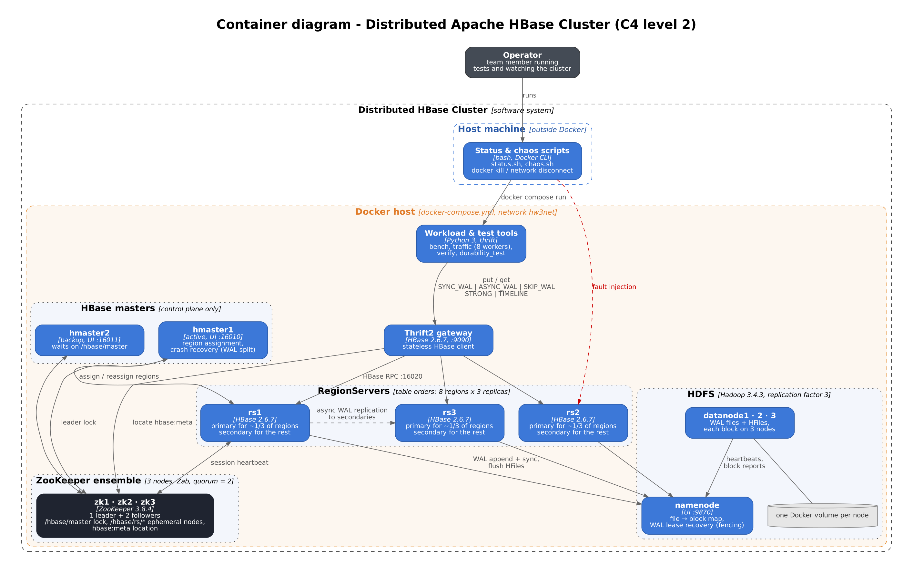

# INFT 6000 HW3: Apache HBase, Distributed Architecture and Chaos Testing

Team 3. A fully distributed Apache HBase 2.6.7 cluster on HDFS and ZooKeeper, running in Docker Compose.
It comes with Python tools that generate traffic, compare consistency and durability settings, inject
faults and check that no acknowledged write was lost.



## What runs

| Container | Count | Role |
|---|---|---|
| `zk1` `zk2` `zk3` | 3 | ZooKeeper ensemble (Zab). Stores the active-master lock, the live RegionServer list and the `hbase:meta` location. Tolerates 1 failure. |
| `namenode` | 1 | HDFS metadata (which blocks make up which file). |
| `datanode1-3` | 3 | HDFS block storage. Every block of every WAL and HFile is stored 3 times. |
| `hmaster1` `hmaster2` | 2 | HBase masters. One is active, the other waits as backup. The active one assigns regions and runs crash recovery. Masters are **not** on the read/write path. |
| `rs1` `rs2` `rs3` | 3 | RegionServers. Each region has exactly one primary RegionServer that accepts writes. |
| `thrift` | 1 | Thrift2 gateway: lets the Python clients use the HBase client API. |
| `init` | 1 | One-shot job that creates the `orders` table. |
| `client` | on demand | Python 3 tools in `client/`. |

**Table `orders`:** column family `d`, pre-split into 8 regions on the first character of the row key
(`2 4 6 8 a c e`), with `REGION_REPLICATION => 3`, so each region has one primary and two read-only
secondary replicas on different RegionServers. Row keys are salted (`<salt>-<order id>`, with the salt
taken from `order_id % 8`), so sequential order ids are spread over all regions instead of hot-spotting one.

## Requirements

- Docker Desktop with **at least 6 GB of memory** (Settings → Resources)
- About 3 GB of disk for images. The first build downloads Hadoop 3.4.3 and HBase 2.6.7 from Apache.

## Run

```bash
git clone https://github.com/aysuazammadova/inft6000-hw3-hbase.git
cd inft6000-hw3-hbase
docker compose up -d --build      # first build downloads ~850 MB, then the start takes ~2 min
docker compose logs -f init       # wait for "[init] done"
./scripts/status.sh               # ZooKeeper modes, HDFS nodes, masters, region placement
```

Full end-to-end check (start, benchmark and all five fault scenarios, ~15 min, log in `results/selftest.log`):

```bash
./scripts/selftest.sh
```

Web UIs: HMaster http://localhost:16010 (backup on 16011), RegionServers on 16030-16032, HDFS NameNode http://localhost:9870

### 1. Baseline: consistency and durability tuning

```bash
./scripts/client.sh bench.py
```

| Setting | What it changes |
|---|---|
| `SKIP_WAL` / `ASYNC_WAL` / `SYNC_WAL` | Whether the write is in the replicated WAL on HDFS before the client gets "OK". This trades write latency for durability. |
| `STRONG` read | Served only by the region's primary, so it always returns the latest acknowledged value. |
| `TIMELINE` read | Asks the primary first. If there is no answer within 10 ms, the secondaries are asked too, and the first answer wins. The result is flagged `stale` when a secondary answered. |
| Freshness probe | Writes a value, then reads it back at once from secondary replica 1. This measures replication lag. |

### 2. Fault injection (each runs while live traffic is running)

```bash
./scripts/chaos.sh rs-crash          # kill -9 a RegionServer: its regions fail over
./scripts/chaos.sh partition         # disconnect a RegionServer from the network, then heal
./scripts/chaos.sh master-failover   # kill the active HMaster: the backup takes over
./scripts/chaos.sh zk-leader         # kill the ZooKeeper leader: the ensemble re-elects
./scripts/chaos.sh wal-loss          # crash with SKIP_WAL vs SYNC_WAL rows in memory
```

The traffic tool prints one line per second. The region map has one character per region:

```
12:00:31 t= 21s | regions ##x##x#x | writes ok  25 fail  15 | STRONG reads ok 25 fail 15 | TIMELINE reads ok 40 stale 15 fail 0
                          ^ regions whose primary was on the crashed server
```

`#` all writes OK, `x` all failed, `~` some failed, `.` no reply this second.
Each run ends with `verify.py`, which reads back every acknowledged key. The expected result is `LOST: 0`.

### Other commands

```bash
./scripts/client.sh traffic.py --duration 60    # traffic only
./scripts/client.sh verify.py                   # verify the latest traffic run
./scripts/client.sh cluster_info.py             # region placement
docker compose down                             # stop (data is kept)
docker compose down -v                          # stop and delete all data
```

## Repository layout

```
docker-compose.yml    cluster definition
docker/               node image (Hadoop + HBase), entrypoint, table creation
conf/                 hbase-site.xml (servers), thrift-site.xml (gateway as client), HDFS config
client/               Python tools: bench, traffic, verify, durability_test, cluster_info
scripts/              status.sh, chaos.sh, client.sh, selftest.sh
docs/                 architecture diagram
report/               technical report
results/              benchmark and traffic output (not committed)
```
